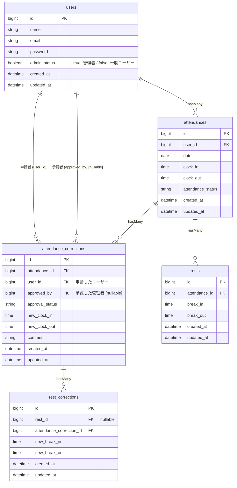

# coachtech 勤怠管理アプリ

## 環境構築手順

### 1. git cloneを実行

Dockerが起動していることを確認<br>

```bash
# ホームディレクトリに移動
cd ~

# git cloneを実行
git clone https://github.com/yuna-genma/attendance-app.git
```

### 2. セットアップ

```bash
# プロジェクトディレクトリに移動
cd attendance-app


# Laravel Sailをインストール
docker run --rm \
    -u "$(id -u):$(id -g)" \
    -v "$(pwd):/var/www/html" -w /var/www/html \
    -e COMPOSER_CACHE_DIR=/tmp/composer_cache \
    laravelsail/php82-composer:latest \
    composer require laravel/sail --dev

# 環境設定ファイルをコピー
cp .env.example .env

# Sailの設定ファイルをパブリッシュ（MySQL,mailpitを選択）
docker run --rm \
    -u "$(id -u):$(id -g)" \
    -v "$(pwd):/var/www/html" \
    -w /var/www/html \
    laravelsail/php82-composer:latest \
    php artisan sail:install --with=mysql,mailpit

```

### 3. envファイルの設定

1.  .envファイルの確認<br>
    `.env`ファイルを開き、データベース接続情報が以下と一致していることを確認する<br>
    一致しない場合は以下の情報に書き換える

```php
 DB_CONNECTION=mysql
 DB_HOST=mysql
 DB_PORT=3306
 DB_DATABASE=laravel
 DB_USERNAME=sail
 DB_PASSWORD=password

 MAIL_MAILER=smtp
 MAIL_HOST=mailpit
 MAIL_PORT=1025
```

### 4. エイリアス設定,Sailの起動

```bash
echo "alias sail='[ -f sail ] && bash sail || bash vendor/bin/sail'" >> ~/.bashrc
exec $SHELL
```

※↓このコードでもエイリアス設定できるが、 Laravelプロジェクトのルートディレクトリ（一番上の階層）にいる時しか動かないため注意が必要

```bash
alias sail="./vendor/bin/sail"
```

1. Sailの起動

    ```bash
    sail up -d
    ```

2. アプリケーションキーの生成
    ```bash
    sail artisan key:generate
    ```
3. Vite開発サーバーの起動
   新しいターミナルを開いて実行する。
   ※このコマンドは開発中、常に実行したままにする。
    ```bash
    sail npm run dev
    ```
4. マイグレーションの実行
    ```bash
    sail artisan migrate:refresh --seed
    ```

### 5. 動作確認

1. Laravelの動作確認<br>
   ブラウザで`http://localhost/login`にアクセスする。<br>
   一般ユーザーのログイン画面が表示される。<br>
   ブラウザで`http://localhost/admin/login`にアクセスする。<br>
   管理者ユーザーのログイン画面が表示される。<br>

2. phpMyAdminの動作確認<br>
   ブラウザで`http://localhost:8080`にアクセスする。
   phpMyAdminが表示されることを確認

    phpMyAdminで`users`、`attendances`、`rests`、`attendance_corrections`、`rest_corrections`テーブルが作られていること・各々に初期データが入力されていることを確認する。

## 使用技術

- Laravel 10
- MySQL 8.0
- Nginx
- Docker
- phpMyAdmin
- Laravel Fortify
- Sanctum

## ER図



## URL

- 開発環境：`http://localhost`
- phpMyAdmin:`http://localhost:8080`
- mailpit:`http://localhost:8025`

## APIエンドポイント一覧

自分の設計したテーブル構成・モデル名に合うように要件シートを変更しました。
要件シートの青字に変更している部分が変更している部分で、要件シートに追記する形で変更しています。また、README.mdにも変更箇所を記載しています。
要件の変更、及び変更箇所を README.md に記載することを、コーチ確認（許可）済です。

### AP01:勤怠一覧API

- エンドポイント：`/api/v1/attendance-records`
- メソッド：`GET`
- 説明：勤怠一覧を取得する。検索・絞り込み・ページネーション対応
- 変更箇所:`AttendanceRecord::with('user', 'breaks')`で関連を eager load⇒`Attendance::with(['user'])`で関連をeager load

### AP02:勤怠詳細API

- エンドポイント：`/api/v1/attendance-records/{attendanceRecord}`
- メソッド：`GET`
- 説明：指定IDの勤怠詳細（ユーザー・休憩・修正申請含む）を取得する
- 変更箇所：`$attendanceRecord->load(['user', 'breaks', 'applications'])`で関連を eager load⇒`$attendanceRecord->load(['user', 'rests', 'attendanceCorrections'])`で関連をeager load

### AP03:勤怠登録API

- エンドポイント：`/api/v1/attendance-records`
- メソッド：`POST`
- 説明：勤怠を新規登録する
- 変更箇所:<br>
    - `auth:sanctum` ミドルウェアによる認証ユーザーから user_id を自動付与し、`$request->user()->attendanceRecords()->create($validated)` で勤怠を作成⇒`$request->user()->attendances()->create($validated)`で勤怠を作成
    - 作成後に `$attendanceRecord->load(['user', 'breaks'])`して AttendanceRecordResource でラップ⇒`$attendanceRecord->load(['user', 'rests', 'attendanceCorrections'])`してAttendanceRecordResource でラップ

### AP04:勤怠更新API

- エンドポイント：`/api/v1/attendance-records/{attendanceRecord}`
- メソッド：`PUT`
- 説明：指定IDの勤怠を更新する
- 変更箇所:更新後に`$attendanceRecord->load(['user', 'breaks'])`して AttendanceRecordResource を返す⇒`$attendanceRecord->load(['user', 'rests', 'attendanceCorrections'])`してAttendanceRecordResource を返す

### AP05:勤怠削除API

- エンドポイント：`/api/v1/attendance-records/{attendanceRecord}`
- メソッド：`DELETE`
- 説明：指定IDの勤怠を削除する。
- 変更箇所:関連 `breaks` / `applications` は ON DELETE CASCADE で削除される⇒関連 `rests`/`attendance_corrections` は ON DELETE CASCADE で削除される

## API Resource の構造

- 変更箇所:`whenLoaded('breaks')` / `whenLoaded('applications') `により、関連データは eager load されたとき（詳細API）のみレスポンスに含まれ、一覧API では自動的に省略される⇒`whenLoaded('rests')` / `whenLoaded('attendanceCorrections')`へリレーション名変更

## 機能確認手順

### テストでの機能確認

```bash
   # プロジェクトディレクトリに移動
   cd contact-form-app

   # 全てのテストを実行
   sail test
```

全てのテストがpassすることを確認する。

## 作成者

源馬　友奈
